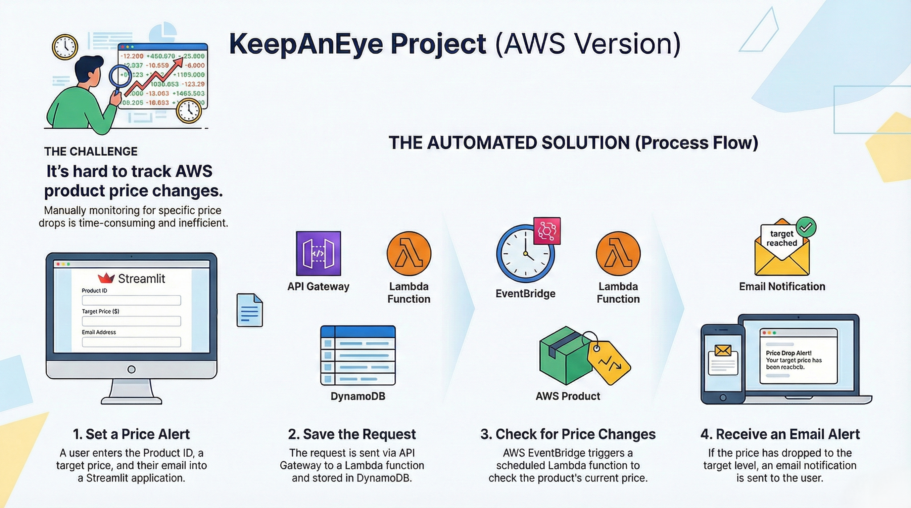
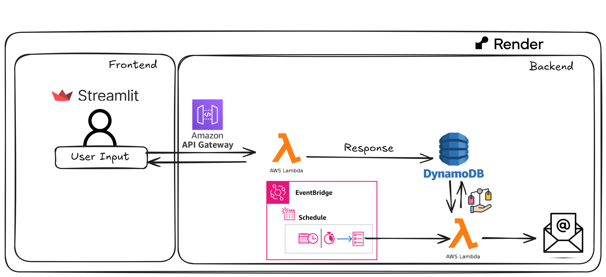

## ☁️ Serverless Full-Stack Architecture via AWS and Streamlit - KeepAnEye (AWS Version)

This repository is designed to track AWS product prices using various AWS services. The project aims to provide a comprehensive solution for monitoring pricing data. Detailed setup instructions and configurations for each component are provided in the respective folders' README.md files. The Python version of the project can be found [here](https://github.com/smitpate07/KeepAnEye).

## High Level Flow

## High Level Tech Flow

## App Link:
Note: The app can be accessed using the link below. The 'Start Tracking' button is disabled on purpose

###  https://keepaneye-aws-pricetracker.onrender.com/
